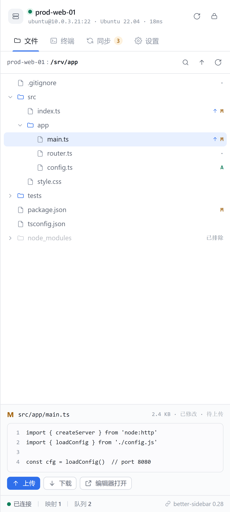
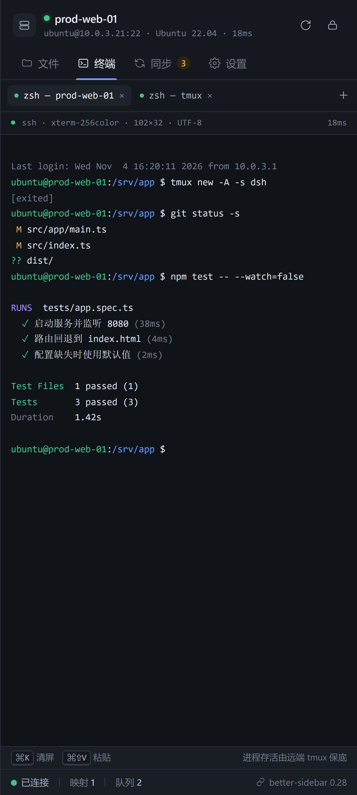
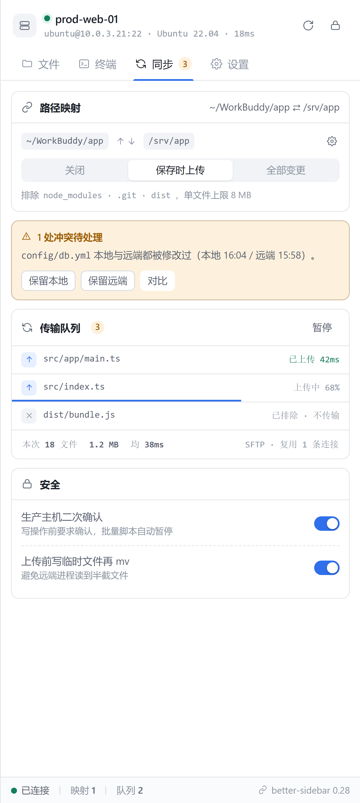

# dsh-remote-ssh

[](https://github.com/LinHao100076/dsh-ssh-remote/actions/workflows/ci.yml)
[](LICENSE)
[](package.json)
[](package.json)

DSH（DeepSeek Harness）的远程 SSH 插件：在侧边栏里看远端文件系统、开远端终端、把远端服务映射到本机，本地改动自动上传、远端文件可下载，并与 `dsh-better-sidebar` 联动。

<p>
  
  
</p>

当前版本 **`0.6.0`**。`0.4.0` 加远端内容搜索，`0.5.0` 加断点续传，`0.6.0` 补上 socks5 动态转发与 `-R` 反向转发。完整变更见 [CHANGELOG](CHANGELOG.md)，下一步见 [ROADMAP](ROADMAP.md)。

## 文档

| 文件 | 内容 |
| --- | --- |
| [CONTRIBUTING.md](CONTRIBUTING.md) | 开发环境、分支与提交约定、测试底线、PR 前自查 |
| [SECURITY.md](SECURITY.md) | 安全模型（凭据怎么存）、已知风险面、私密报告渠道 |
| [ROADMAP.md](ROADMAP.md) | 打算做什么、明确不做什么 |
| [CHANGELOG.md](CHANGELOG.md) | 每个版本改了什么 |
| [docs/design.md](docs/design.md) | 架构取舍的长文档：为什么不做某些事、踩过的坑 |
| [ui/prototype.html](ui/prototype.html) | 界面基准，单文件可直接打开 |

## 两个入口（better-sidebar 是可选的）

| 装了什么 | 出现在哪 | 怎么打开 |
| --- | --- | --- |
| 有 `dsh-better-sidebar` | better-sidebar 的侧栏，**一个**名为「远程 SSH」的标签页 | 侧栏里点「远程 SSH」 |
| 没有 / 停用了 `dsh-better-sidebar` | DSH **自带的右侧边栏**，同一个「远程 SSH」面板 | 会话头部右上角的服务器图标按钮 |

无论走哪条路，面板都是同一个组件：主机头 + 一条标签条（文件 / 终端 / 同步 / 转发 / 设置）+ 状态栏。早先版本在 better-sidebar 里注册了四个标签页，把侧栏挤得很满，`v0.3.0` 起统一成一个（见 issue #1）。

两条路径互斥：如果 better-sidebar 在启动后才激活，插件会把原生入口撤掉、换成同一个标签页，不会同时出现两个入口。

## 目录

```
src/               宿主端：HTTP API、WebSocket 终端、SSH 连接池、文件/传输/同步、端口转发
client/            浏览器端：一个 Workspace 面板 + 五个视图 + 两个入口（better-sidebar 标签页 / 原生右侧边栏）
lib/client.js      构建产物：客户端 bundle（esbuild 打包，由宿主按插件名提供）
lib/server.mjs     构建产物：宿主端 bundle（ssh2 / ws / chokidar 全打进来，包里零运行期依赖）
docs/design.md     架构取舍、平台发现、问题清单、里程碑
docs/assets/       README 用的面板截图（由 ui/prototype.html 生成）
ui/prototype.html  UI 原型（单文件，浏览器直接打开，可切深色）——界面以它为准
test/              十三轮测试（见下）
scripts/           对着真实服务器跑的验收脚本；`dev-remote.mjs` 是本地假远端（exec 走真 shell，SFTP 只读）
```

## 先看原型

双击 `ui/prototype.html`。顶栏可切换界面状态：连接页 / 连接中 / 文件 / 终端 / 同步 / 设置 / 错误。
也支持 `?view=terminal`、`?view=sync` 等直达链接。

> 原型里没有「转发」视图 —— 端口转发晚于原型（`v0.2.0`），那一屏是照着原型的 token 与栅格补的，没有回填进原型。改转发界面时以 `client/forward-view.jsx` 和 `client/styles.js` 为准。

面板按原型的 424px 设计，宽度跟着右侧栏走；原型里的深色版本通过 `light-dark()` 复用同一套 token，自动跟随 DSH 的主题。

## 核心判断（详见 docs/design.md）

1. 这不是一个 SSH 客户端，而是「本地工作区的远端影子」——因为 agent 和 better-sidebar 都在本地工作。
2. DSH 有 `ctx.fs` / `ctx.subprocess` 执行世界抽象，理论上可以把整个 harness 搬到远端；但 better-sidebar 绕过 `ctx.fs` 直读本地（grep 它的 `src/` 里没有任何 `ctx.fs` / `ctx.subprocess`），两条路线混用会产生 split-brain。
3. 因此 v0.x 走「本地镜像 + 旁挂远端通道」，执行世界替换作为 v1.0 独立 profile 实验。

## 装到 profile 里

推荐用发布包安装（一条命令，DSH 自己会把它写进 `dsh.profile.bundles`）：

```bash
npm run pack:rel     # 生成 dist/dsh-remote-ssh-<版本>.tgz
dsh plugin --profile <profile> add -w "C:/绝对路径/dsh-remote-ssh-0.3.4.tgz"
```

`-w` 不能省：profile 里有 `pnpm-workspace.yaml`，pnpm 认为根是 workspace root，不带 `-w` 会报 `ERR_PNPM_ADDING_TO_ROOT`。

装完 `package.json` 会变成：

```json
"dsh": { "profile": { "bundles": ["@deepseek-ai/dsh-base", "@deepseek-ai/dsh-web-app", "dsh-remote-ssh"] } },
"dependencies": { "dsh-remote-ssh": "file:C:/.../dsh-remote-ssh-0.3.4.tgz" }
```

**不要解压 tgz 后指向解压出来的目录。** pnpm 会把本地目录写成 `link:`，而链接进来的目录不会安装它自己的依赖 —— 一旦插件还有 `dependencies`，宿主端第一次 `import` 就会 `ERR_MODULE_NOT_FOUND`，整个插件停用，界面上只留一句「启用失败」。

`0.3.1` 起这条坑已经填了：发布包里**没有任何运行期依赖**。`ssh2`、`ws`、`chokidar` 全部被 esbuild 打进 `lib/server.mjs`（约 980 KiB），装到哪都一样能跑，`link:` 也行。所以包里 `dependencies` 是空的，`ssh2` 也不再在安装期尝试编译原生模块。

然后启动（app 参数直接跟在后面，不要写 `web`）：

```bash
dsh --profile <name> --no-open --port 4987
```

`desktop` profile 由桌面应用独占，CLI 会拒绝（`profile "desktop" is managed exclusively by the Electron application`）。这种 profile 请在应用内的插件页面安装，或手工改 `package.json` 的 `bundles` 与 `cordis.patch.yml` 后重启应用。

开发期想直连源码目录（改代码立即生效，但要自己保证 `lib/client.js` 已构建）时，也可以只在 `cordis.patch.yml` 里插入：

```yaml
- insert:
    - id: dsh-remote-ssh
      name: "dsh-remote-ssh"
```

插件自己在 `~/.dsh/storages/dsh-remote-ssh/state.json` 存主机与映射。**密码和口令永不落盘**，只存在浏览器内存里，每次连接现取。

## 终端与 tmux

远端有 tmux 时自动执行 `tmux new -A -s dsh-<host>`：刷新页面、IDE 重启、网络抖动之后都重新接回同一个 shell。  
远端没有 tmux 时退回普通登录 shell，并在终端上方给出明确警告（「刷新页面或断线后，本次会话的进程会一起结束」），而不是假装一切正常。

两个分支都有测试覆盖（`test/e2e-profile.mjs`），包括 tmux 存在时实际下发的 argv 是 `tmux new -A -s dsh-xxx`。

## 远端搜索

文件视图工具条上的放大镜：在**远端**跑 `rg`（没有则 `grep -r`），只把命中的行拿回来 —— 不下载文件、不建本地索引，所以能搜的永远比映射里的多。

- **默认字面量 + smart-case**：输入 `foo` 忽略大小写，输入 `Foo` 就区分大小写；`Aa` 强制区分，`.*` 才按正则解释。
- **结果按文件分组**，点任意一条打开文件并滚到那一行；超长行围绕命中位置裁剪，不会出现「预览里看不出为什么命中」。
- **范围是当前目录**：`rg` 尊重 `.gitignore`；没有 `rg` 时 `grep` 显式跳过 `.git`、`node_modules`、`.venv`、`__pycache__`、`target`、`dist`、`build`、`.next`、`.cache`、`.idea`。
- **上限 200 条**并明确标出截断；切断发生在远端（`head -n`），一个巨型仓库不会把数据灌进宿主进程。
- **输出通道**：`rg --json` / `grep -rInZ`（文件名后跟 NUL）。`path:line:text` 那种格式一遇到带冒号的路径或正文就解析错，而错的结果比没有结果更糟。老版本 `rg` 不认 `--json` 时自动降级到 `grep` 并记住。

想试搜索、文件树、终端但手上没有服务器，用仓库里的假远端（`exec` 走本机 `sh`，命令拼错、引号写错当场暴露；SFTP 只读，删不掉真文件）。它也能转发：`direct-tcpip` 从本机连出去、`tcpip-forward` 在本机开监听再推通道回来，所以三种转发都能对着它真跑一遍：

```bash
node scripts/dev-remote.mjs /path/to/project 2202
# 面板里新建主机 127.0.0.1:2202，用户和密码随便填
```

## 端口转发（-L / -D / -R）

「转发」标签页里一条规则的形状是**一端监听 → 一端目标**，类型决定哪一端在本机：

| 类型 | 监听 | 目标 | 等价于 |
| --- | --- | --- | --- |
| 本地 | 本机 | 远端 host:port | `ssh -L 6379:127.0.0.1:6379 me@server` |
| 动态 | 本机（SOCKS5） | 每次连接再定 | `ssh -D 1080 me@server` |
| 反向 | 远端 | 本机 host:port | `ssh -R 8080:127.0.0.1:3000 me@server` |

**本地 -L** 是把远端只监听 `127.0.0.1` 的服务 —— Redis、Postgres、前端 dev server —— 映射到本机；**动态 -D** 是在本机开一个 SOCKS5 代理，目标地址交给客户端指定、在服务器上解析，适合一次访问内网里的一堆服务（`curl --socks5-hostname 127.0.0.1:1080 http://intranet/`）；**反向 -R** 是反过来，让服务器监听一个端口，把流量送回本机，适合把本地 dev server 临时给服务器用。

| 项 | 行为 |
| --- | --- |
| 绑定地址 | 默认 `127.0.0.1`；选 `0.0.0.0` 会在面板顶部标红 —— 对 `-L`/`-D` 是把远端服务暴露给整个局域网，对 `-R` 是把**你的本机**暴露给服务器所在的网络 |
| 启动时机 | 默认随主机连接自动启动；也可以关掉改成手动 |
| 连接复用 | 走主机已建立的 SSH 连接（`-L`/`-D` 用 `direct-tcpip`，`-R` 用 `forwarded-tcpip`），不需要二次认证 |
| 掉线恢复 | 本地监听器不随连接断开而销毁：下一条入站连接会惰性重连。`-R` 的监听端口在服务器上、连接一断就没了，所以重连后会自动重新申请；没申请回来时面板会明确显示「服务器上的端口暂时不存在」而不是假装还在监听 |
| 端口冲突 | 按「监听端 + 端口」判重，`0.0.0.0:8080` 与 `127.0.0.1:8080` 视为冲突（系统本来就不给两个）；`-L` 和 `-R` 用同一个端口号不算冲突，它们监听在不同机器上 |
| 停止 | 停止规则或断开主机时关闭监听、掐断已建立的隧道，`-R` 还会通知服务器停止监听（`cancel-tcpip-forward`） |

远端服务拒绝连接（服务没起来）和 SSH 层失败是两种错误码（`target-refused` / `transport`），面板能分别提示。

SOCKS5 只实现 `CONNECT`。`BIND` 和 `UDP ASSOCIATE` 会明确回 `0x07 command not supported` 而不是不吭声 —— 一个等不到回复的客户端是「卡住」，而代理里的卡住会被当成网络问题。握手和请求允许被拆成任意多个包到达，也允许客户端把第一个请求数据紧跟在握手后面一起发（那些字节会被原样接上，不会丢）。

## 路径映射与同步语义



- **默认单向**：本地 → 远端（agent 改的文件自动推上去）。按映射开双向后，远端变更才会被下载。
- **本地是真相**：冲突判定 = 本地改过 **且** 远端 mtime 相对基线漂移超过 2s；冲突只报告，不自动裁决，由 UI 给「保留本地 / 保留远端 / 忽略」。
- **删除不传播**：本地删除只在队列里记一笔，绝不会在远端 `rm`。
- 写入用临时文件 + rename 落地，避免 agent 读到半个文件；远端可执行位按本地 mode 推（Windows 上靠 `modeTemplate` 补回来）。

### 断点续传

传输是**分块**的（1 MiB 一块，顺序写），不是整包 `fastPut`/`fastGet`：

- 两个方向都先写同目录的 part 文件（`<名字>.dsh-part-<大小>-<mtime>`），**结束后才 rename 成真名**。所以真实文件名下永远不会出现半个文件。
- **part 文件的大小就是断点**。中断、断线、进程重启后重试同一个文件，会从 part 的末尾接着传，只补发剩下的部分。
- part 名字里带源文件的大小和 mtime。源文件变了 → 指纹变了 → 旧的 part 不会被拿来拼接（宁可重传，也不生成一个「前半是旧版本、后半是新版本」的文件）。
- 目录遍历会跳过 part 文件，它们不会被当成内容同步过去。

残留的 part 只会在「中断」或「源文件改过」时出现。同步面板每个映射卡片上有「清理残留」，它只删 part 文件，并告诉你清掉了多少个、多少字节。

> 顺序写而不是并发写：并发写不同偏移会在 part 里留下空洞，`size` 就不再等于「已写入的字节数」，断点也就不可信了。代价是吞吐受单通道往返限制（局域网实测约 45 MB/s），换来的是续传永远正确。

## 连接、密码与主机切换

未连上主机时，文件和终端两个视图会先显示一个连接门（`client/connect-view.jsx`），而不是一片空白。门上有：

- **主机列表**：点一行即切主机；当前主机用强调色描边。
- **密码框**：认证方式是密码的主机，密码直接在这里输 —— `type="password"`，回车即连。值只进内存里的 `secretStore`，**不写磁盘、不进日志、不随状态持久化**。
- **「改用密码」**：密钥认证失败（`auth-failed` / `key-invalid`）时一键切换到密码，不用先去设置页改认证方式。
- **明确的失败原因**：`auth-failed` / `bad-password` / `no-agent` / `timeout` / `refused` / `dns-failed` / `host-key-changed` 各有中文标题，原始 stderr 放在错误框里。

主机切换的第二个入口是面板标题栏的主机名：点一下弹出主机菜单（在线状态徽标 + 新建 / 管理），不用切到别的视图。

主题：面板不给自己的调色板之外的颜色 —— 亮/暗两套色值直接取自 `ui/prototype.html`，用 `light-dark()` 绑到宿主的 `color-scheme` 上。没有用 `--dsw-alias-*`：当前构建里品牌色是近黑（`#0f1115`）、边框是 4% 黑，套上去会把原型的蓝色强调和所有分隔线抹平。

## 验证

```bash
npm test             # 先自动 build（两个 bundle），再跑十三轮 Node 测试
```

`npm test` 有 `pretest` 钩子，会先重建两个 bundle —— 否则渲染测试可能跑在旧产物上，改了代码却仍报绿。

| 套件 | 覆盖 |
| --- | --- |
| `test/smoke.mjs` | 路由、主机、映射、转发规则的增删与校验、落盘、排除规则、终端帧 |
| `test/ssh.mjs` | 握手、认证、exec、PTY、TOFU、错误分类、连接复用。跑两遍：一遍对 `src/`，一遍对 `lib/server.mjs`（`--bundle`），证明内联进来的 `ssh2` 还能握手 |
| `test/files.mjs` | 列表、文本守卫、原子写、陈旧检测、目录操作 |
| `test/transfer.mjs` | 分块传输与断点续传：中断后从 part 文件大小继续、只补发剩余、源文件变化时指纹不匹配不复用、过期 part 不被误用、清理只删 part、目录遍历跳过 part |
| `test/forward.mjs` | 三种转发都是真实 TCP 往返：`-L` 穿透 `direct-tcpip`、`-D` 走完整 SOCKS5 握手（含管道化首包、失败回 0x05）、`-R` 穿透 `forwarded-tcpip` 并在断线重连后重新申请端口、停止时让服务器释放端口；另加通配地址判重、字节统计、端口占用、autoStart、落盘无密码 |
| `test/socks5.mjs` | SOCKS5 协议层：握手/请求被拆成多包、管道化数据原样返回、IPv4/IPv6/域名三种地址、`BIND` 回 0x07、空域名与 0 端口回 0x08、只给需认证方法时回 0xff、非 SOCKS 客户端直接断开、静默客户端超时、错误码映射 |
| `test/render.mjs` | 用真实 React（`react-dom/server`）渲染五个视图 + 连接门四态 + 原生工作区，并断言密码框存在（issue #2），捕捉只在渲染时炸的错 |
| `test/native.mjs` | 两个入口的取舍：有 better-sidebar 时**一个**标签页、没有时原生类型/面板/头部按钮、后激活时的交接、卸载后无残留 |
| `test/api.mjs` | 草稿主机的 id 按目标稳定（重复点「测试连接」复用一条连接、不占用当前主机的槽位），编辑已有主机时沿用已钉的指纹（issue #5 回归） |
| `test/styles.mjs` | 样式表注入：落到承载面板的那个 document、重复调用幂等、上一版残留的旧表就地刷新（issue #3 回归）、没有 head 不抛 |
| `test/search.mjs` | 远端内容搜索：`rg --json` 与 `grep -rInZ` 两条输出通道（含路径/正文带冒号）、大小写三档、命中两侧裁剪、`head` 截断、老版 rg 降级到 grep、真 shell 下的引号与排除目录（`rg` 缺失时用 `grep -E` 跑正则） |
| `test/ws.mjs` | 用**构建产物里的** `WebSocketServer` 加真客户端对打，跨 ws 的 48/32/24 三个阈值与拆帧（issue #4 回归：空对象打桩曾让 `bufferUtil.unmask` 变成未捕获异常，一点终端就崩宿主） |

浏览器产物检查（在真实 Chrome 里加载 bundle，验证标签页注册、order 46、重复挂载幂等、卸载后清空）：

```bash
chrome --headless=new --dump-dom test/bundle-check.html
```

对着真实服务器验收（连接、环境探测、tmux、UTF-8 读写、上传下载字节一致、PTY 回显）：

```bash
node scripts/check-ssh.mjs
```

在真实 DSH profile 里验收（需要先起一个 profile 并拿到 cookie jar）。它会走完整网关验证：路由挂载、cookie 准入、两条终端分支、PTY 往返、以及经 HTTP 下发的端口转发真实穿透一次：

```bash
RS_ORIGIN=http://127.0.0.1:4987 RS_COOKIE_JAR=/path/to/jar node test/e2e-profile.mjs
```

## 版本与分支约定

- **`main` 永远是可用版本**。每次发版打附注标签（`v0.1.0`、`v0.2.0`…），标签说明里写清两件事：凭什么算可用、还差什么。用 `git tag -n99 -l` 或 `git show v0.1.0` 查看。
- **新功能一律从 `main` 切 `feat/<名字>`**，做完 `--no-ff` 合回 `main`。**分支合完保留，不要删**——后面回看某个功能的独立历史、或者在旧功能上接着改都要用到它。名字用短横线：`feat/port-forward`、`feat/remote-search`、`feat/resume-transfer`。
- 提交信息用 conventional 前缀：`feat:` 新功能、`fix:` 修缺陷、`docs:` 文档、`test:` 测试、`chore:` 杂项。

```bash
git switch -c feat/remote-search             # 开工
git commit -am "feat: 远端 rg 搜索"
git switch main && git merge --no-ff feat/remote-search
git tag -a v0.3.0 -m "v0.3.0 —— 远端搜索"      # 发版
```

### 发布包

```bash
npm run pack:rel      # 先跑 build，再 npm pack 到 dist/
```

`prepack` 钩子保证打包前一定重建 `lib/client.js`，所以包里不会出现旧产物。包内只含运行期需要的东西：`src/`、`lib/client.js`、`lib/server.mjs`、`cordis.patch.yml`、`README.md`、`LICENSE`、`package.json`（23 个文件，约 376 KB）。`dist/` 不进版本库——它可以从任何一个标签重新生成。

`test/`、`scripts/`、`docs/` 不进包，所以装到别处后跑不了 `npm test`；要在包装好的产物上验证，就在源码目录里跑。

### 发版流程

```bash
git tag -a v0.x.0 -F -        # 标签说明写两点：凭什么算可用、还差什么
git push origin main
git push origin v0.x.0        # 标签不会跟着 main 自动推，必须单独推
```

然后在 GitHub 上发 Release 并附上 `dist/dsh-remote-ssh-<版本>.tgz`。标签说明是这个项目最重要的一份文档：它记录的是「在这个时间点，什么被验证过、什么还没有」，比 CHANGELOG 更细。

分支不用手工清理：合完的分支一律保留并推到远端（见 [CONTRIBUTING.md](CONTRIBUTING.md)）。

## 环境

- DSH `0.2.0-rc.2`
- `dsh-better-sidebar` `0.28.0`（peer，optional）
- Node ≥ 20

注意：`dsh-better-sidebar@0.28.0` 的 peer 要求是 `^0.2.1-rc.1`，在 `0.2.0-rc.2` 上 DSH 会**跳过**这个 bundle。跳过不影响本插件：它会改用原生右侧边栏 + 会话头部按钮作为入口。想继续用 better-sidebar 的两个选择：

1. **降到 `0.26.1`**（peer 是 `^0.2.0-rc.2`，天然匹配，不需要任何豁免，`registerTab` 契约一致）：`dsh plugin --profile <name> add -w dsh-better-sidebar@0.26.1`。
2. 或给 `0.28.0` 授权豁免：

```bash
dsh plugin --profile <name> version-exemptions      # 看当前被拦的包与运行时版本
dsh plugin --profile <name> allow-version dsh-better-sidebar@0.28.0 \
  --dsh-version 0.2.0-rc.2 --accept-risk
```

豁免写在 `<profile>/compatibility.json`，只对「这个包的这个版本 + 这个运行时版本」生效，升级任一侧都要重新授权。`desktop` profile 由应用独占，这条命令要在应用内的插件页面执行。

本插件不依赖 better-sidebar 启动：服务不在时走原生入口（见上文「两个入口」）；服务在时按下面的契约注册。

| 项        | 契约                                                                                                                      |
| -------- | ----------------------------------------------------------------------------------------------------------------------- |
| 注册       | `ctx.inject(['betterSidebar'], svc => svc.registerTab(descriptor))`，返回 disposer                                         |
| 描述符      | `id / title / description / icon / order / component`；`title` 与 `icon` 可以是函数（插件内部用 `textOf` / `iconOf` 解析，`icon(size)`） |
| 重复 id    | 原生实现会 `throw`，所以注册前用 `getTab(id)` 跳过（HMR 重挂不炸）                                                                          |
| 组件 props | `ctx, store, scope, tab, visible, expanded, revealed, …`，面板用 `scope.sessionId` 与 `visible`                              |

原生入口用的是 DSH 自带的那套（`dsh-web-app` bundle 里的 `ui-sidebar-right`），不依赖任何第三方插件：

| 项 | 契约 |
| --- | --- |
| 类型 | `sidebarRightTabs.register({ id, kind, priority: 'extension', title, guide })`，`id` 与 `kind` 都是 `dsh-remote-ssh` |
| 面板 | `ctx.slots.inject('sidebar.right.pane.tab', () => ctx.slots.register({ name, key: id, inject: (sessionId) => props }, Component))` |
| 入口按钮 | `conversation.session.header.utilities` 槽（list 槽，用 `id`），点击调 `sidebarRight.openTab('dsh-remote-ssh')` |
| 读取服务 | 客户端 ctx 是 Proxy，**未 `inject` 的服务读属性会抛** `cannot get property "x" without inject`；一律用 `ctx.get(name)` |
| 路由前缀 | HTTP 用 `document.baseURI`（反代前缀跟着走）；桌面壳页面是 `dsh-app://`，WebSocket 必须改用 `__DSH_TRANSPORT__.streamBaseUrl` |

## 参与贡献

欢迎 issue，尤其是**带复现路径的 bug**：现象 + 截图 + 点哪里出错，三样齐了基本当场能定位。

- 想改代码：先读 [CONTRIBUTING.md](CONTRIBUTING.md)。两条硬规则在那儿 —— 界面以 `ui/prototype.html` 为准、包里零运行期依赖。
- 安全相关：走 [SECURITY.md](SECURITY.md) 的私密渠道，不要开 public issue。
- 想提功能：先看 [ROADMAP.md](ROADMAP.md)，里面既有已经排队的，也有明确不做的。

`npm test` 是这个仓库的底线：十三轮全绿才合。关键协议（转发、SOCKS5、终端 WebSocket）不许用测试桩替代，历史上就是这么漏掉过一个「一点终端就崩宿主」的 bug。

## 许可证

[MIT](LICENSE) © 2026 LinHao100076
